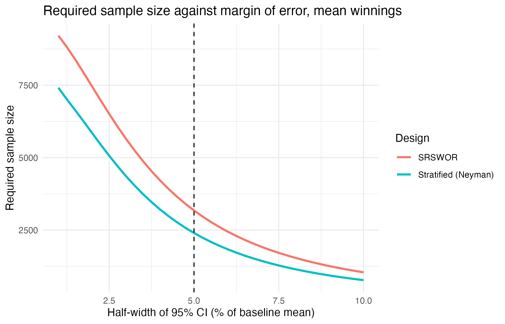
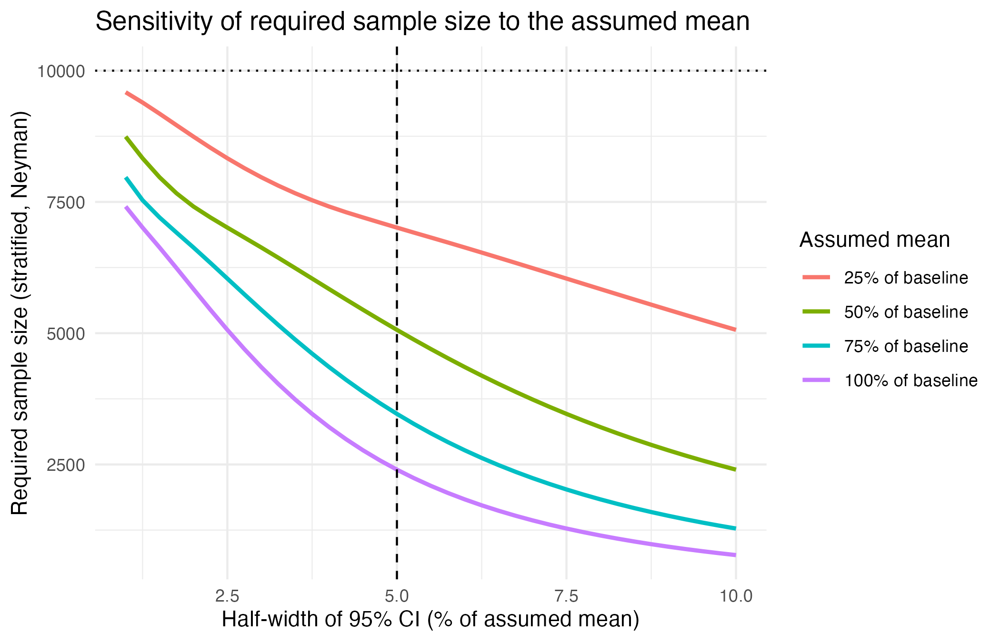
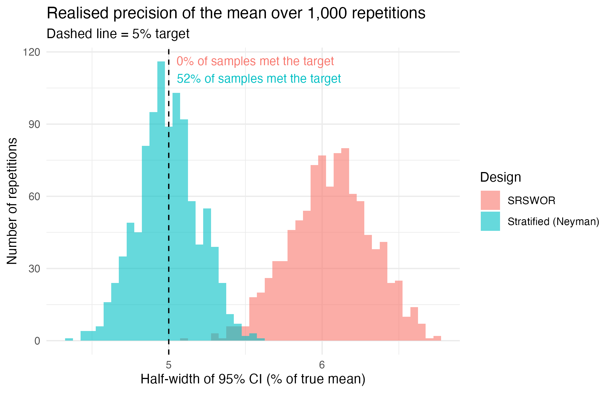

```{r setup, include=FALSE}
knitr::opts_chunk$set(echo=FALSE, warning=FALSE, message=FALSE,
  fig.align="center", out.width="100%", fig.pos="H")
pop <- read.csv("data/population.csv")
smp <- read.csv("data/sample.csv")
d <- read.csv("output/D_estimates.csv")
p <- read.csv("output/E_performance.csv")
b <- read.csv("output/B_allocation.csv")
sens <- read.csv("output/B_sensitivity.csv")
w <- read.csv("output/D_weights.csv")
naive <- read.csv("output/D_naive_vs_design.csv")
num <- function(x, digits=0) formatC(x, format="f", digits=digits, big.mark=",")
tab <- function(x, ...) knitr::kable(x, row.names=FALSE, booktabs=TRUE, ...)
```

## Abstract

This study evaluates a stratified probability survey of a fixed population of 10,000 simulated *Deal or No Deal* contestants. The primary objective is to estimate mean winnings in US dollars with a 95% confidence-interval half-width no greater than 5% of its baseline value. Region-based Neyman allocation is compared with simple random sampling without replacement (SRSWOR). Allowing for 90% response, 2,670 contestants were selected and 2,391 responded. The weighted mean was \$67,453 (95% CI: \$64,111--\$70,795), compared with the true mean of \$67,430, and met the precision target. Across 1,000 repetitions per design, stratification reduced the mean's empirical variance by 32%, with coverage compatible with 95%. However, it increased the variance of the secondary proportion below opening expected value by 67%. The results demonstrate the value of stratification and weighting for the primary outcome, while showing that allocation gains are outcome-specific and that planned precision does not guarantee the precision of every realised sample.

## 1. Introduction and literature review

*Deal or No Deal* presents contestants with a sequence of choices between a guaranteed banker offer and an uncertain prize. Although the expected value of a known prize board is readily calculated, actual winnings also depend on offers and contestants' decisions. Mean winnings therefore provide a useful summary for a broadcaster's prize-budget planning, while the proportion below the opening expected value describes how frequently payouts fall below that benchmark.

This study designs and evaluates a probability survey of **10,000 simulated contestants** from stylised UK, US and Australian versions of the game. It asks: what are mean winnings and the proportion below opening expected value; does region stratification improve precision relative to SRSWOR; and do the estimators show small bias and approximately 95% interval coverage over repeated sampling? All conclusions concern the constructed finite population rather than actual television contestants.

The primary parameter is
\[
\bar Y=N^{-1}\sum_{i=1}^N y_i,\qquad N=10{,}000,
\]
where $y_i$ is contestant $i$'s winnings in USD. The secondary parameter is $P=N^{-1}\sum_i I(y_i<EV_{h(i)})$, where $EV_{h(i)}$ is the opening expected value of the contestant's regional board. Falling below this benchmark describes an outcome; it does not establish that a contestant made an irrational decision.

Post et al. (2008) study *Deal or No Deal* as a setting for risky choice with substantial stakes. Their work motivates the behavioural setting, but the offer curve and decision parameters used here are assumptions rather than fitted estimates from that study. The present question concerns population-level payouts and survey precision, rather than the estimation of individual preferences.

Neyman (1934) establishes the allocation principle underlying the primary design: with equal unit costs, samples are allocated in proportion to stratum size and within-stratum standard deviation. Cochran (1977) and Lohr (2010) explain the corresponding finite-population variance and weighting framework. This suggests that region may be useful because prize scales differ, but an allocation optimised for winnings need not also be efficient for a binary outcome.

Repeated sampling provides a way to assess those theoretical expectations. Following Morris, White and Crowther (2019), this study compares bias, empirical and estimated standard errors, interval coverage and Monte Carlo uncertainty. Together, the realised survey and simulation assess both the immediate precision gain and its consistency across samples.

## 2. Methodology

### 2.1 Population and sampling design

The target population contains 10,000 simulated contestants: 4,000 UK, 4,000 US and 2,000 Australian. The sampling frame is a register with one record per person, including a unique identifier, region, age, gender and opening board value. It covers the whole target population, so target and sampled populations coincide. Each contestant is both the sampling unit and the observation unit reporting winnings and game details. In practice, incomplete registers could exclude eligible contestants.

Each game randomly assigns the regional board's prizes to boxes, keeps one box for the contestant, and opens the others in random order. UK games use 22 prizes (GBP 0.01--250,000), opening 5 boxes and then 3 in each of five rounds. US and Australian games use 26 prizes and opening counts 6, 5, 4, 3, 2, 1, 1, 1, 1. The US maximum is USD 1 million; the Australian maximum is AUD 2 million. The Australian board and its schedule are modelling assumptions, not a verified reconstruction of a particular series.

After round $r$ of $R$, the offer is $f_r$ times the mean unopened prize, where
\[
f_r=\min\{[0.15+0.85((r-1)/(R-1))^{1.5}]e^{\epsilon_r},1.10\},
\quad \epsilon_r\sim N(0,0.10^2).
\]
Contestants accept the first offer at least equal to their CRRA certainty equivalent,
\[
CE=\left[m^{-1}\sum_{j=1}^m(w+x_j)^{1-\rho}\right]^{1/(1-\rho)}-w.
\]
At $\rho=1$, the certainty equivalent is $\exp\{m^{-1}\sum_j\log(w+x_j)\}-w$. If every offer is refused, the contestant receives the prize in their own box. This myopic rule ignores future offers.

Age is a rounded $N(40,12^2)$ draw **clipped** to 18--75; gender is assigned Female/Male with equal probability. Risk aversion is $\max\{0,N(0.4+0.01(\mathrm{age}-40),0.3^2)\}$. Wealth is lognormal with median USD 20,000 and log-SD 0.8, converted to local currency for decisions. Fixed modelling factors of 1.27 USD/GBP and 0.66 USD/AUD convert winnings back to USD. They are not dated exchange-rate observations. The population was generated in R with seed 20261019.

```{r population-summary}
ps <- do.call(rbind,lapply(split(pop,pop$region),function(x)
 data.frame(Region=x$region[1], N=num(nrow(x)), Share=nrow(x)/nrow(pop),
 Mean=num(mean(x$winnings_usd)), SD=num(sd(x$winnings_usd)),
 `Below EV`=num(100*mean(x$below_ev),1), check.names=FALSE)))
tab(ps, caption="Population structure. Mean and SD are in USD; below EV is a percentage.")
```

The true values are $\bar Y=\$67{,}429.76$ and $P=0.7498$. Winnings are right-skewed: the median is \$26,624 and the SD is \$117,400. This arises from many modest payouts and relatively few large prizes.

Region determines prize scale and stratum SDs differ substantially. Neyman allocation concentrates sampling where variability is greatest, improving precision under equal unit costs. Regional registers also simplify selection and contact. Proportional allocation requires 2,990 respondents for the primary target, compared with 2,401 under continuous Neyman allocation. Cluster sampling could inflate variance if contestants in the same recording series have similar outcomes; no cost evidence justifies that trade-off here.

### 2.2 Sample size and precision

The target is a **95% confidence-interval half-width** of no more than 5% of the baseline mean: $e=0.05\bar Y=\$3{,}371.49$. Let $z=1.959964$ and $V=(e/z)^2$. Baseline means and stratum variances are treated as known prior information, as permitted by the brief. This is a planning assumption, not information obtained from the realised sample.

For SRSWOR, using the finite-population variance $S^2$ with denominator $N-1$,
\[
n_0=(zS/e)^2,\qquad n=\frac{n_0}{1+n_0/N}.
\]
For stratified sampling, $W_h=N_h/N$ and
\[
\operatorname{Var}(\bar y_{st})=\sum_h W_h^2(1-n_h/N_h)S_h^2/n_h.
\]
With equal unit costs, unconstrained Neyman allocation and its required size are
\[
n_h=n\frac{N_hS_h}{\sum_hN_hS_h},\qquad
n=\frac{(\sum_hN_hS_h)^2}{N^2V+\sum_hN_hS_h^2}.
\]
The factors $1-n_h/N_h$ are the finite population corrections. There are no clusters, so an intracluster correlation is not required. The planned design effect is the ratio of stratified to SRSWOR variance at the same respondent count; for the mean it is approximately 0.68.

\needspace{8\baselineskip}

```{r allocation}
a <- data.frame(Region=b$region, Share=b$W_h,
 `$S_h^2$ (USD$^2$)`=num(b$S_h^2),
 Respondents=num(b$n_h), Selected=num(b$n_h_final), check.names=FALSE)
tab(a, caption="Neyman allocation, stratum variances and non-response allowance.")
```

The continuous result rounds to 2,401 respondents; rounding **each stratum up** gives a feasible plan of **2,402**. This conservative integer allocation is not asserted to be the exact integer optimum. Assuming 90% independent response, selection counts are $\lceil n_h/0.9\rceil$, totalling **2,670**. Inflation gives the desired response count in expectation, not a guarantee. The corresponding SRSWOR requirement is 3,178 respondents, so the stratified plan reduces respondent demand by about 24%.

For the secondary proportion, use $S_{ph}^2=N_hP_h(1-P_h)/(N_h-1)$. Its target is $0.05P=0.03749$. An allocation separately optimised for the proportion needs 486 respondents (488 under SRSWOR); these are **not** the allocation used for the survey. The mean-based allocation still comfortably meets this secondary precision target.

The unconstrained formula can imply $n_h>N_h$. The calculation caps such strata at a census and recalculates the optimum for the remaining strata. Census strata contribute zero sampling variance, while all population weights stay fixed. This constraint matters at tight precision targets, although no stratum reaches its population capacity in the final selection of 2,670 contestants.

The sensitivity analysis examines how the required sample size changes with the precision target and assumed baseline mean.

```{r margin, out.width="69%", fig.cap="Required continuous sample size versus relative half-width. Stratified allocations respect each stratum's population capacity."}

```

```{r sensitivity, out.width="69%", fig.cap="Four assumed means with fixed stratum sizes and SDs. Tighter absolute margins require larger samples."}

```

The quantities held fixed are $N=10{,}000$, $N_h$, $S_h$, 95% confidence and the capacity-constrained Neyman rule. Only the assumed mean changes; each curve uses $e=qk\bar Y$, with $k=0.25,0.50,0.75,1$ and $q$ the relative margin. Thus lower means imply smaller absolute margins, with SDs deliberately unchanged. At $q=5\%$, the required stratified sizes are **`r paste(num(sens$n_strat), collapse=", ")`**, respectively. These are respondent planning sizes before non-response inflation. Curves show continuous optima; implementable allocations require integer rounding. A smaller assumed mean therefore raises the required sample sharply: at 25% of the baseline the stratified design needs `r num(sens$n_strat[1])` respondents (about `r round(100*sens$n_strat[1]/nrow(pop))`% of $N$), against `r num(sens$n_srswor[1])` under SRSWOR. As $n$ approaches $N$, the finite population correction increasingly limits the required size, and the stratified design needs fewer respondents than SRSWOR at every assumed value.


\newpage

### 2.3 Selection, weighting and data collection

The planned number of contestants is selected independently within each region using SRSWOR. Every population member has a known positive selection probability $\pi_i=n_h/N_h$, with design weight $d_i=1/\pi_i$. Here $n_h$ denotes selected contestants; the realised responding count is $r_h$.

```{r weights}
tab(data.frame(Region=w$region, Selected=num(w$n_h),
 `$\\pi_i$`=num(w$pi_i,4), `Design weight $d_i$`=num(w$w_design,3),
 Respondents=num(w$r_h), `Final weight $w_i$`=num(w$w_final,3), check.names=FALSE),
 caption="Selection probabilities and respondent weight adjustment.")
```

Independent Bernoulli response with probability 0.90 gives **2,391 responses (89.6%)**. Respondents receive $w_i=N_h/r_h$ and nonrespondents receive final weight zero. Final weights sum to each known regional count and to 10,000 overall. A UK respondent represents about 10.6 population members; a US respondent represents about 2.8. Equal weighting would overrepresent regions selected at higher rates.

Conditional on $r_h$, independent equal-probability response leaves an SRSWOR of $r_h$ from region $h$. This justifies analysing respondents with weights $N_h/r_h$ and respondent-level finite population corrections. It would not justify the same analysis if response depended on winnings within regions.

The population dataset contains all 10,000 individuals. The realised sample records all 2,670 selected individuals, including ID, stratum, inclusion probability, design weight, response flag, final weight, outcome and auxiliary variables. Outcomes are missing for nonrespondents. Latent risk aversion and wealth are simulation variables; the questionnaire's self-reported risk rating and wealth bands are only proposed proxies.

Contestants would receive an online questionnaire or telephone interview through the production company. The instrument in Appendix A records winnings in local currency, deal acceptance and round. With consent, production records would verify winnings. The opening expected value comes from the frame and determines the secondary indicator after currency conversion.

- **Coverage:** missing or outdated contestant records could exclude particular eras or regions. Reconcile registers and update contact details before selection.
- **Non-response:** winners with large payouts might respond differently. Follow-up and response comparisons on frame variables could help; weighting alone cannot remove unmeasured within-region selection bias.
- **Measurement:** recalled winnings can be rounded or confused with advertised prizes. Specify actual main-game payouts and verify records where permitted.
- **Processing and valuation:** currency miscoding changes outcomes. Check currency and amount ranges. Fixed conversion factors define this model's estimand but do not measure historical purchasing power.

## 3. Analysis

### 3.1 Realised estimates and design comparison

Design-based estimation accounts for independent individual selection, regional strata, final respondent weights and finite population corrections. Confidence intervals use a normal approximation at the 95% level. The estimators are
\[
\hat{\bar Y}_{st}=\sum_hW_h\bar y_h,\qquad
\hat V(\hat{\bar Y}_{st})=\sum_hW_h^2(1-r_h/N_h)s_h^2/r_h.
\]
Replacing $y_i$ by $I(y_i<EV_{h(i)})$ estimates $P$ and its variance. The CV is SE divided by the estimate. The benchmark selects 2,670 individuals by SRSWOR, then simulates independent 90% response; 2,404 respond, with weight $N/r$ and variance $(1-r/N)s^2/r$.

```{r mean-results}
m <- d[d$parameter=="winnings_usd",]
tab(data.frame(Measure=c("Estimate (USD)","Estimated variance", "SE (USD)",
 "95% CI", "CV (%)", "Survey design effect", "CI half-width (USD)"),
 Stratified=c(num(m$estimate[1]),num(m$variance[1]),num(m$se[1]),
 paste(num(m$ci_lower[1]),num(m$ci_upper[1]),sep=" to "),num(100*m$cv[1],2),
 num(m$deff[1],3),num(m$half_width[1])),
 SRSWOR=c(num(m$estimate[2]),num(m$variance[2]),num(m$se[2]),
 paste(num(m$ci_lower[2]),num(m$ci_upper[2]),sep=" to "),num(100*m$cv[2],2),
 num(m$deff[2],3),num(m$half_width[2]))), caption="Primary parameter: realised-sample estimates.")
```

The stratified interval covers the true mean and its half-width of \$3,342 meets the \$3,371 target. The benchmark half-width is \$4,132 and misses the target. The naive stratified-sample mean is \$84,806, an error of \$17,376 (26%); weighting reduces the realised error to \$23. One sample's error is not itself an estimate of repeated-sampling bias.

```{r proportion-results}
a <- d[d$parameter=="below_ev",]
tab(data.frame(Measure=c("Estimate", "Estimated variance", "SE", "95% CI", "CV (%)", "Survey design effect"),
 Stratified=c(num(a$estimate[1],4),num(a$variance[1],7),num(a$se[1],4),
 paste(num(a$ci_lower[1],4),num(a$ci_upper[1],4),sep=" to "),num(100*a$cv[1],2),num(a$deff[1],3)),
 SRSWOR=c(num(a$estimate[2],4),num(a$variance[2],7),num(a$se[2],4),
 paste(num(a$ci_lower[2],4),num(a$ci_upper[2],4),sep=" to "),num(100*a$cv[2],2),num(a$deff[2],3))),
 caption="Secondary proportion; true value 0.7498.")
```

Both proportion intervals cover the truth and meet the 0.03749 target. The unweighted proportion is 0.7583, versus the weighted 0.7528. Because the proportion's stratum SDs are similar, its best allocation is close to proportional; the mean-driven allocation, which heavily undersamples the UK, therefore raises its variance.

The tabulated design effects compare each estimated variance with an estimated SRSWOR reference variance at the same respondent size. Ratios of variances from the two independently drawn realised samples are instead **0.654 for the mean and 1.579 for the proportion**. The latter is not the table's 1.623; the benchmark respondent counts and estimated reference variances differ.

\newpage

### 3.2 Repeated-sampling performance

Selection, non-response, weighting and estimation are repeated **1,000 times per design** using the same fixed population. Every replicate retains estimates, SEs, interval limits and respondent counts.

Following Morris, White and Crowther (2019), performance is assessed by bias, relative bias, empirical SE, average estimated SE, RMSE, coverage and interval width. For $R$ repetitions and truth $\theta$,
\[
\widehat{\mathrm{Bias}}=R^{-1}\sum_b\hat\theta_b-\theta,\quad
\mathrm{RMSE}=\sqrt{R^{-1}\sum_b(\hat\theta_b-\theta)^2},\quad
\mathrm{MCSE}(\hat c)=\sqrt{\hat c(1-\hat c)/R}.
\]
Empirical SE is the sample SD of estimates; the empirical design effect is the ratio of their variances, stratified over SRSWOR.

```{r simulation-table}
getp <- function(par, des) p[p$parameter==par & p$design==des,]
ms <- getp("Mean winnings","Stratified (Neyman)")
mr <- getp("Mean winnings","SRSWOR")
ps <- getp("Proportion below opening EV","Stratified (Neyman)")
pr <- getp("Proportion below opening EV","SRSWOR")
vals <- function(x,dig) c(num(x$mean_estimate,dig),num(x$bias,dig),
 num(100*x$relative_bias,3),num(x$empirical_se,dig),num(x$avg_estimated_se,dig),
 num(x$rmse,dig),num(100*x$coverage,1),num(100*x$mc_se_coverage,2),
 num(x$avg_ci_width,dig),num(x$empirical_deff,2),num(100*x$pct_meeting_5pct,1))
tab(data.frame(Measure=c("Average estimate","Bias","Relative bias (%)", "Empirical SE",
 "Average estimated SE","RMSE","Coverage (%)","Coverage MCSE (pp)",
 "Average CI width","Empirical design effect","Meets bound (%)"),
 `Mean: strat.`=vals(ms,2), `Mean: SRS`=vals(mr,2),
 `Prop.: strat.`=vals(ps,4), `Prop.: SRS`=vals(pr,4),check.names=FALSE),
 caption="Performance over 1,000 repetitions. pp = percentage points.")
```

All relative biases are below 0.15% in magnitude. The mean's bias MCSEs are approximately \$56 (stratified) and \$67 (SRSWOR); observed biases of \$30 and -\$97 are within two MCSEs of zero. Coverage ranges from 94.3% to 95.2%, with MCSEs around 0.7 percentage points, consistent with nominal 95% coverage at this simulation resolution.

Average estimated SEs for the mean are about 2% below empirical SEs. This is a descriptive comparison, not proof that the variance estimators are biased: average SE and average variance are different measures, and simulation estimates have Monte Carlo error.

Stratification reduces the mean's empirical variance by 32% and RMSE by 17%; its average interval is \$6,735 wide versus \$8,164 for SRSWOR. For the proportion, variance increases by 67%, demonstrating the trade-off from optimising allocation for winnings.

\newpage

```{r precision-figure, out.width="60%", fig.cap="Distribution of realised primary-parameter interval half-widths over 1,000 repetitions. The dashed line marks the 5% target."}

```

The stratified design meets the mean's precision bound in **52.1%** of repetitions; the same-sized SRSWOR design meets it in none. The sample was planned using baseline variances and expected response counts. Realised response counts and estimated variances fluctuate, so satisfying the planning equation does not guarantee that every estimated interval meets the bound. The approximately one-half rate is specific to this experiment, not a universal property of sample-size formulas.

For a practical survey, planning for a tighter half-width, such as 4.5%, or a lower anticipated response rate would provide a buffer. Such choices should be evaluated against cost and desired assurance before collecting data. Both designs meet the secondary proportion's precision target in every repetition here.

## 4. Conclusion

For this finite population, mean winnings are about **\$67,400** and approximately **75%** win less than their board's opening expected value. Neyman allocation reduces the mean's required respondents by 24% and empirical variance by 32%, while sacrificing precision for the proportion. Weighting is essential. Bias and coverage results support the design under the stated assumptions; practical planning should allow a buffer beyond the nominal precision target.

The simulated outcome distribution depends on assumed prize boards, offer progression, wealth and risk aversion. The Australian high-stakes setting is intentionally stylised, and fixed currency factors restrict interpretation. The model does not estimate real contestants' behaviour or regional winnings. The age distribution is clipped at its limits rather than sampled from a truncated normal distribution.

Sampling and variance calculations also assume a complete frame, equal within-region response propensities and accurate measurements. Non-response weights are valid for the simulated mechanism but would not automatically remove outcome-dependent response bias in a real survey. The normal intervals appear adequate in this large-sample experiment; this does not establish their performance for much smaller samples or other populations.

\newpage

## References

Cochran, W. G. (1977). *Sampling techniques* (3rd ed.). Wiley.

Lohr, S. L. (2010). *Sampling: Design and analysis* (2nd ed.). Brooks/Cole.

Lumley, T. (2004). Analysis of complex survey samples. *Journal of Statistical Software, 9*(8), 1--19. <https://doi.org/10.18637/jss.v009.i08>

Morris, T. P., White, I. R., & Crowther, M. J. (2019). Using simulation studies to evaluate statistical methods. *Statistics in Medicine, 38*(11), 2074--2102. <https://doi.org/10.1002/sim.8086>

Neyman, J. (1934). On the two different aspects of the representative method: The method of stratified sampling and the method of purposive selection. *Journal of the Royal Statistical Society, 97*(4), 558--625.

Post, T., van den Assem, M. J., Baltussen, G., & Thaler, R. H. (2008). Deal or no deal? Decision making under risk in a large-payoff game show. *American Economic Review, 98*(1), 38--71. <https://doi.org/10.1257/aer.98.1.38>

\newpage

## Appendix A: Proposed questionnaire

**Purpose and consent.** This proposed academic survey concerns main-game winnings. Participation is voluntary; respondents may skip an item or stop. Responses would be used for aggregate analysis. A real deployment would first add approved consent, privacy, retention and researcher-contact details.

Confirm the contestant's ID and regional version against the register.

1. What amount did you actually receive from the main game, before tax or personal expenses? Record the amount and currency (GBP / USD / AUD). Exclude unrelated promotional awards. Allow “do not recall”.
2. Did you accept a banker offer? (Yes / No / Do not recall.)
3. If yes, after which round? Record the round number or “do not recall”.
4. At the time you played, how willing were you to take financial risks, from 0 (not willing) to 10 (very willing)? Optional.
5. At that time, what was your approximate household savings balance in the show's local currency? (Below 5,000 / 5,000--19,999 / 20,000--49,999 / 50,000 or more / Prefer not to say.) Optional.
6. May the production company confirm your reported winnings from its records? (Yes / No.)

Region, age, gender and opening expected value are frame variables. Items 4 and 5 are contextual proxies and are not used to estimate the primary mean. The exact CRRA coefficient and wealth used in the simulation would not be directly observed by this instrument. No real respondents were contacted for this project.

## Appendix B: Files and reproducibility

Run `Rscript run_all.R` from the project folder. It executes scripts in isolated environments, checks the outputs, records `sessionInfo()` and renders this report. R packages required are `survey`, `ggplot2`, `scales`, `knitr` and `rmarkdown`; PDF rendering also requires Pandoc and XeLaTeX. Use `--no-render` to run just the analysis and checks.

| File | Role / seed |
|:---|:---|
| `01_simulate_population.R` | Generate population; 20261019 |
| `02_sample_size.R` | Planning and capacity-constrained sensitivity |
| `03_draw_sample.R` | Stratified selection and response; 20261020 |
| `04_estimation.R` | Survey estimates and benchmark; 20261021 |
| `05_simulation.R` | 1,000 repetitions per design; 20261022 |
| `06_extra_figures.R` | Additional deterministic figures |
| `validate.R` | Data and output integrity checks |
| `report.Rmd` | Report source; tables read executed output files |

Estimation uses the R *survey* package (Lumley, 2004), with regional strata, respondent weights and population counts declared in `svydesign`. The simulation checks closed-form estimates and standard errors against this implementation for both outcomes and both design formulas before repeating sampling; the checks consume no random numbers. Seeds are listed above. The output retains average estimated variances as well as the performance measures reported in the analysis.

The `data/` folder contains the full population and both selected samples. The `output/` folder contains planning tables, estimates, replicate results, performance summaries and software versions. The README provides run instructions and a field dictionary.

\newpage

## Appendix C: Declaration of generative AI use

**To be completed by the author before submission.**

\vspace{1cm}

Tools used:

\vspace{2cm}

Parts of the project for which AI was used:

\vspace{2cm}

How the work was reviewed and verified:

\vspace{2cm}

Author's final declaration:
